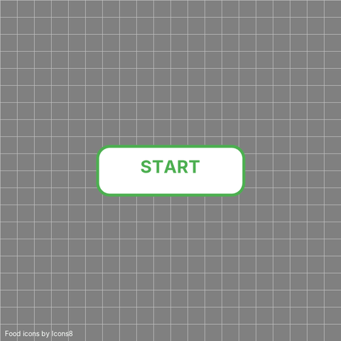

# Snake Game in Java

The classic Snake game, written in Java with Swing. I built it for my Data Structures and Algorithms course (CSCI 5557) at Fairleigh Dickinson University in fall 2024. The goal of the assignment was to use a data structure in something that actually runs, so the snake's body is stored as a linked list.



## How to play

Click **START**, then steer with the arrow keys. Each orange square you eat adds one segment to the snake and one point to your score. Hitting a wall or your own body ends the game.

## Running it

You need JDK 17 or newer. There are no other dependencies.

```bash
git clone https://github.com/yusun1218/snake-game-java.git
cd snake-game-java
java src/SnakeGame.java
```

Java 11+ can run a single source file directly, so there's no separate compile step. If you prefer to compile first:

```bash
javac -d out src/SnakeGame.java
java -cp out SnakeGame
```

## How the snake moves

The board is a 28 x 28 grid of 25-pixel tiles. A Swing `Timer` fires every 140 ms, and on each tick the snake moves one tile:

```java
snakeBody.addFirst(newHead);
snakeHead = newHead;

if (collidesWith(food)) {
    placeFood();
} else {
    if (snakeBody.size() > 1) {
        snakeBody.removeLast();
    }
}
```

Moving is really just two operations: put a new tile at the front and take one off the back. When the snake eats, the back tile stays, which is how it grows.

That's why I used `LinkedList` instead of `ArrayList`. Adding to the front of an `ArrayList` shifts every element over, so it gets slower as the snake gets longer. A linked list adds to the front and removes from the back in constant time no matter how long the snake is.

Other parts of the game:

- **Collision checks.** Before moving, the new head position is checked against the board edges and against every tile in the body.
- **No instant reversing.** The key handler ignores a turn straight back into the snake's own direction (left while moving right, for example).
- **Food placement.** Food appears on a random tile using `java.util.Random`.
- **Drawing.** Everything is drawn with `Graphics2D` in `paintComponent`, including the start button and the game over box. There are no image files.

## What I'd improve next

Looking back at this code now, these are the things I'd change:

- **Fast turns can still kill the snake.** The reversal check compares against the current direction, but the snake only moves once per tick. If you press Up and then Left quickly while moving right, both keys are accepted before the snake moves, and it turns straight into itself. Storing key presses in a queue and applying one per tick would fix this.
- **Food can land on the snake.** `placeFood()` picks any tile, including ones the snake is on. It should keep picking until it finds an empty tile.
- **No restart.** After game over you have to close and reopen the window.
- **Constant speed.** Speeding up the timer as the score goes up would make it more interesting.

## Files

```text
src/SnakeGame.java     the whole game (about 260 lines)
screenshots/           gameplay recording for this README
```
